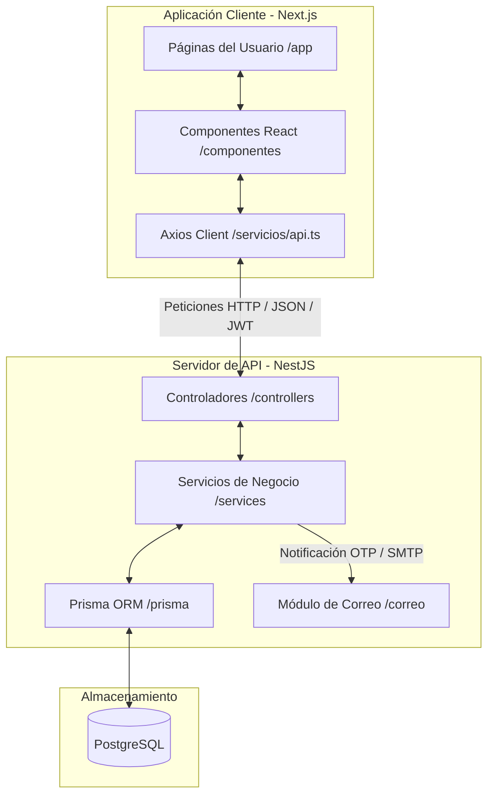

# Guía Explicativa de la Arquitectura y Código de la Plataforma EMSE

Esta guía ha sido creada especialmente para ti, para que puedas entender a la perfección cada detalle técnico de tu proyecto, sepas explicarlo con propiedad y profesionalismo en tu sustentación, y conozcas qué archivos puedes optimizar o limpiar.

---

## 1. Arquitectura General y Tecnologías Seleccionadas

El proyecto está diseñado bajo una arquitectura moderna de **Desacoplamiento Completo (Decoupled Fullstack)**. El frontend y el backend funcionan como aplicaciones totalmente independientes, comunicándose a través de solicitudes HTTP estructuradas en formato JSON.

### Resumen del Stack Tecnológico
* **Frontend**: Next.js 15 (React), Tailwind CSS (estilización), Axios (solicitudes HTTP), TypeScript.
* **Backend**: NestJS (Node.js framework), Prisma ORM (gestión de base de datos), PostgreSQL (base de datos relacional), Bcrypt (cifrado de contraseñas), NodeMailer (envío de correos OTP).

### ¿Por qué estas tecnologías para la EMSE?
La plataforma está titulada como: **"PLATAFORMA INSTITUCIONAL DE GESTIÓN DOCUMENTAL Y ACADÉMICA CON TRAZABILIDAD Y NOTIFICACIONES EN TIEMPO REAL BASADA EN WORKFLOW Y MODELADO BPM"**.
1. **Seguridad y Rigor Militar**: NestJS impone una estructura fuertemente modular por defecto (Módulos, Controladores, Servicios). En un entorno donde la seguridad es primordial, esta arquitectura evita el código desordenado y facilita la auditoría.
2. **Trazabilidad de Procesos (BPM y Workflows)**: PostgreSQL y Prisma ORM permiten definir esquemas de bases de datos altamente relacionales con llaves foráneas estrictas. Esto garantiza la integridad de los datos; por ejemplo, que una firma o un flujo de aprobación documental siempre esté atado inequívocamente a un usuario y sección reales.
3. **Optimización y Rapidez**: Next.js ofrece una velocidad de carga excelente y modularidad a través de Componentes de React. Esto facilita una UI muy responsiva y interactiva, ideal para las notificaciones en tiempo real y el modelado visual de flujos de trabajo.
4. **Ciberseguridad (MFA y JWT)**: En vez de un inicio de sesión convencional que puede ser vulnerable, la plataforma implementa una verificación en dos pasos (Multi-Factor Authentication - MFA) enviando un código OTP (One Time Password) al correo electrónico institucional del usuario. Las sesiones subsecuentes se firman mediante tokens JWT seguros.

---

## 2. Diagrama de Flujo y Comunicación

Así es como interactúa todo tu sistema desde que el usuario abre la página de inicio hasta que inicia sesión correctamente:

---

## 3. Explicación Detallada de las Carpetas

### A. Frontend (`/frontend`)

* **`public/`**: Contiene recursos estáticos que el navegador descarga de forma directa. Aquí están los logos de la EMSE e imágenes de fondo.
* **`src/app/`**: Es la estructura de rutas basada en carpetas (App Router). 
  * **`page.tsx`**: La página de inicio pública donde se muestra la EMSE (Misión, Visión, landing page).
  * **`layout.tsx`**: Define la cáscara del sitio (fuentes, estructura HTML base).
  * **`globals.css`**: Contiene la paleta de colores del sistema. Nota los elegantes colores militares oscuros y dorados suaves (`--color-military-green`, `--color-soft-gold`).
  * **`iniciar-sesion/page.tsx`**: Contiene el formulario de login y la pantalla secundaria para meter el código OTP que se manda por correo.
  * **`panel/page.tsx`**: El dashboard o panel de control principal que ve el usuario una vez dentro.
  * **`acceso-restringido/page.tsx`**: Pantalla de error cuando un usuario intenta entrar a una sección para la cual su Rol no tiene autorización.
  * **`modulos/`**: Subcarpetas para cada sección del sistema:
    * **`control-acceso/usuarios/page.tsx`**: Interfaz interactiva donde los administradores pueden ver la tabla de usuarios, crear nuevos, y desactivarlos.
    * **`academico/` y `documentacion/`**: Carpetas creadas como marcadores de posición (placeholders) que representan los módulos que se construirán en las siguientes etapas del proyecto.
* **`src/componentes/`**: Piezas visuales reutilizables.
  * **`layout/`**: Contiene `BarraLateral.tsx` (menú de navegación izquierdo), `BarraSuperior.tsx` (cabecera con información del usuario actual) y `LayoutProtegido.tsx` (el guardián que verifica en el lado del cliente si tienes sesión activa antes de dejarte ver el panel).
  * **`control-acceso/`**: Contiene `TablaUsuarios.tsx` (lista interactiva de usuarios) y `FormularioUsuario.tsx` (formulario emergente para registro de nuevo personal).
  * **`publico/`**: Elementos de la landing page pública (`NavbarPublico.tsx`, `FooterPublico.tsx`).
* **`src/servicios/`**: Lógica de conexión con el Backend.
  * **`api.ts`**: Configura Axios con la URL base `http://localhost:3000` y tiene un interceptor que inyecta automáticamente el token JWT de seguridad en las cabeceras HTTP de cada llamada.
  * **`control-acceso/usuarios.service.ts`**: Llama a los endpoints `/usuarios` del backend para crear, listar o desactivar.
* **`src/tipos/`**: Modelos de datos estáticos en TypeScript (Interfaces) como `usuario.ts`, `rol.ts` y `permiso.ts`. Evita inconsistencias de nombres de campos en el frontend.

---

## 4. Explicación Detallada de las Carpetas

### B. Backend (`/backend`)

* **`prisma/`**: Contiene el archivo clave `schema.prisma`. Aquí es donde se modela la base de datos PostgreSQL. Define las tablas de:
  * `Usuario` (Datos del personal, contraseña cifrada, estado).
  * `Rol` (Roles como Administrador, Docente, Cadete).
  * `Seccion` (Jerarquía militar o administrativa: Compañía, Dirección Académica, etc.).
  * `Permiso` (Permisos individuales como "GESTIONAR_USUARIOS").
  * `RolPermiso` (Tabla intermedia que asocia qué permisos tiene cada rol).
  * `Sesion` y `CodigoVerificacion` (Registros de seguridad para auditoría y validación OTP).
* **`src/`**: La lógica del servidor NestJS estructurada en módulos:
  * **`main.ts`**: Punto de entrada de la aplicación. Configura el puerto `3000` y habilita **CORS** para que tu frontend pueda realizar solicitudes al backend sin ser bloqueado por políticas del navegador.
  * **`app.module.ts`**: Es el mapa o índice principal que le dice a NestJS qué módulos cargar en memoria al arrancar.
  * **`prisma/`**: Expone la conexión a la base de datos para que cualquier otro módulo pueda inyectarla y realizar consultas.
  * **`modulos/control-acceso/`**:
    * **`autenticacion/`**: El cerebro de la seguridad. Tiene `autenticacion.service.ts` que se encarga de verificar que el CI y la contraseña coincidan, generar el código aleatorio OTP, guardarlo en base de datos temporalmente y, si la verificación de OTP es exitosa, emitir un token JWT firmado.
    * **`usuarios/`**: Proporciona los controladores (`usuarios.controller.ts`) y servicios (`usuarios.service.ts`) para dar de alta a usuarios cifrando su contraseña con `bcrypt`, listar usuarios activos con sus respectivos roles y secciones asociadas, y desactivar usuarios (cambiar su estado a falso en lugar de borrarlos físicamente de la BD, manteniendo así la integridad histórica de los registros).
    * **`correo/`**: Integra NodeMailer con un servidor SMTP para disparar los correos con los códigos OTP de forma automática cuando el usuario intenta loguearse.

---

## 5. Diagnóstico de Archivos Redundantes y qué Puedes Eliminar

Para optimizar al máximo tu código y dejarlo impecable para su presentación o entrega final, te sugiero las siguientes acciones:

### 1. Eliminar el archivo Duplicado de Lock-file (CRÍTICO)
* **¿Qué pasa?:** En la carpeta `/frontend` tienes tanto `package-lock.json` (NPM) como `yarn.lock` (Yarn). Esto ocurre cuando se inicializa el proyecto con un gestor y luego se instalan dependencias con otro. Puede causar que las dependencias difieran entre computadoras de desarrollo o servidores de producción.
* **Solución:** Como tu backend está estandarizado en NPM, lo mejor es estandarizar también el frontend a NPM. 
* **Acción:** **Elimina el archivo `frontend/yarn.lock`**. Quédate únicamente con `package-lock.json` y de ahora en adelante instala dependencias usando `npm install`.

### 2. Archivos de pruebas unitarias (`*.spec.ts`)
* **¿Qué pasa?:** En NestJS, cada vez que creas un controlador o servicio, el CLI genera automáticamente archivos de pruebas unitarias como `usuarios.service.spec.ts`.
* **Solución:** Si para tu sustentación académica no te exigen pruebas unitarias escritas ni cobertura de código (Unit Testing con Jest), estos archivos están completamente vacíos de pruebas reales.
* **Acción:** **Puedes eliminarlos** con toda tranquilidad (por ejemplo: borrar `usuarios.service.spec.ts`, `autenticacion.controller.spec.ts`, etc.). No afectará en lo absoluto el funcionamiento de tu servidor y dejará las carpetas del backend mucho más limpias y fáciles de entender visualmente.

### 3. Directorios de Módulos Vacíos (Placeholders)
* **¿Qué pasa?:** Carpetas como `frontend/src/app/modulos/academico/` y `frontend/src/app/modulos/documentacion/` están totalmente vacías.
* **Solución:** Son marcadores de posición que le dicen al examinador de tu tesis: *"Miren, aquí va a ir el módulo de BPM y trazabilidad documental, y aquí la sección académica"*.
* **Acción:** **NO los elimines**. Son la prueba visual de que tu arquitectura ya está estructurada para soportar modularmente el desarrollo de las siguientes fases del proyecto EMSE.

### 4. Archivos de Configuración de Herramientas de IA
* **¿Qué pasa?:** En la raíz del frontend tienes los archivos `AGENTS.md` y `CLAUDE.md`. Son meramente instrucciones para asistentes virtuales inteligentes.
* **Solución:** No aportan funcionalidad a la aplicación y no son estándar en proyectos productivos.
* **Acción:** **Puedes eliminarlos** antes de empaquetar o entregar el código final a tu institución educativa para dar una impresión de software 100% limpio y profesional.

---

## 6. Flujo Práctico de Autenticación de un Usuario

1. El usuario entra en la web de la EMSE (Landing Page) y hace clic en **"Iniciar Sesión"**.
2. Rellena su **CI** (Cédula de Identidad) y **Contraseña**.
3. El frontend envía estos datos por POST a `/autenticacion/iniciar-sesion`.
4. El backend busca el usuario por su CI en la base de datos, extrae la contraseña cifrada y utiliza `bcrypt` para compararla con la contraseña ingresada.
5. Si coinciden, el backend genera un código OTP único (ej. `539104`), lo almacena en la base de datos vinculándolo al usuario con un tiempo de expiración de 10 minutos, y envía un correo electrónico formateado usando el servicio `correo.service.ts`.
6. El backend responde al frontend indicando que se requiere validación de dos pasos. El frontend muestra la vista de inserción de código.
7. El usuario abre su correo, copia el código OTP y lo introduce en la interfaz.
8. El frontend envía el código a `/autenticacion/verificar-codigo`.
9. El backend valida que el código sea correcto, no haya sido utilizado previamente y no esté expirado. Si todo es correcto, emite un **Token JWT** seguro.
10. El frontend guarda el token y el perfil básico de permisos en el `localStorage`, redirigiendo al usuario al Dashboard (`/panel`), donde el `LayoutProtegido` le da acceso a las vistas de acuerdo a sus permisos granulares.
